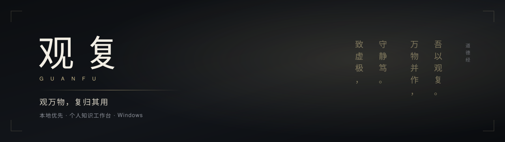
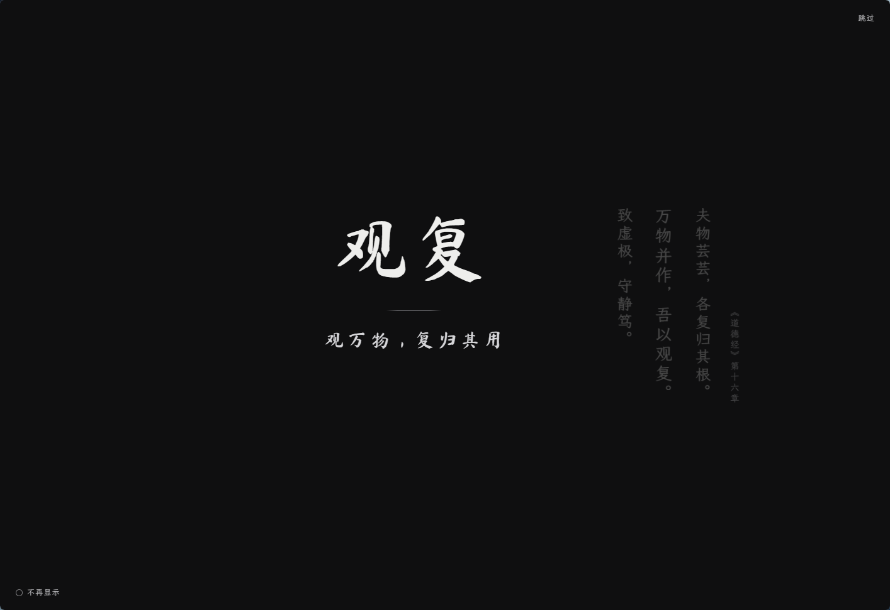
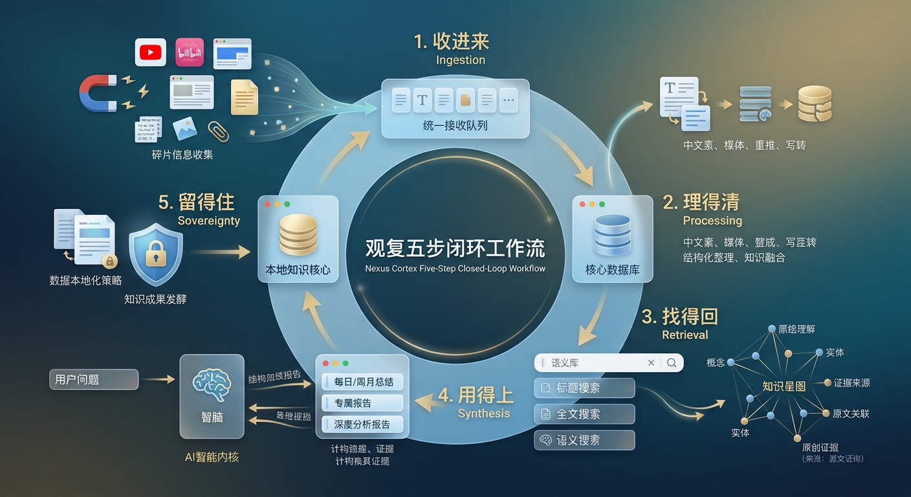
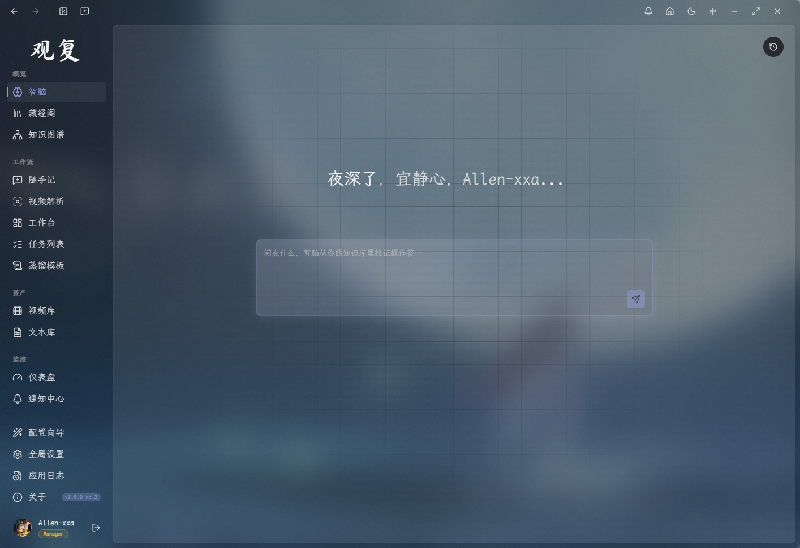
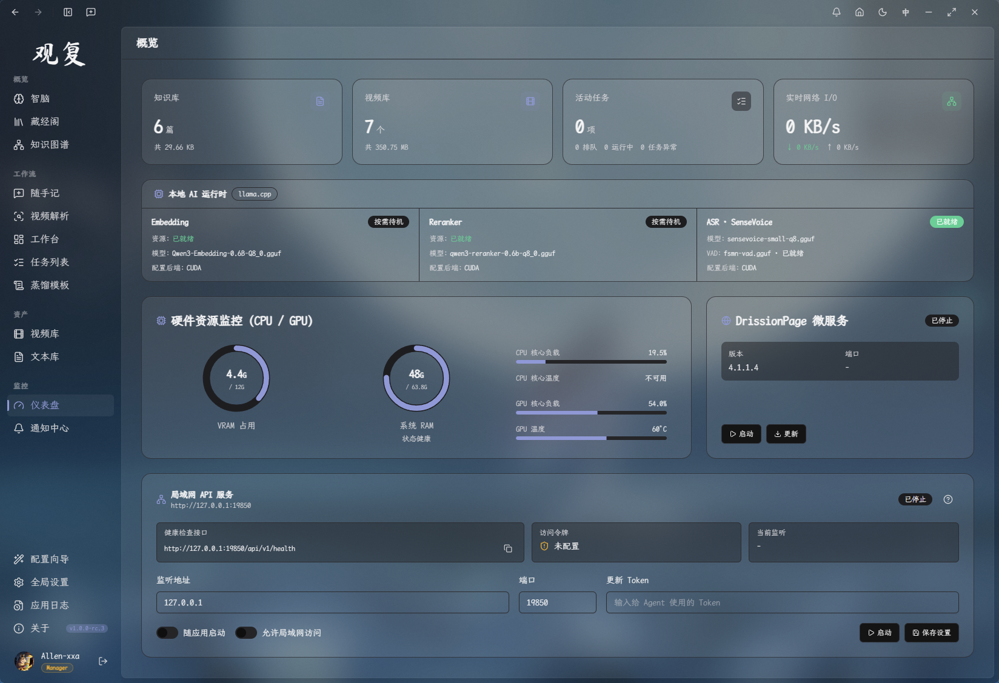
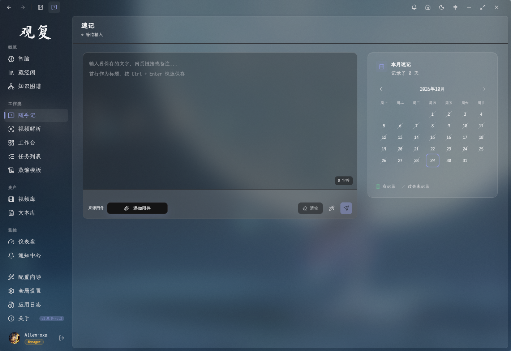
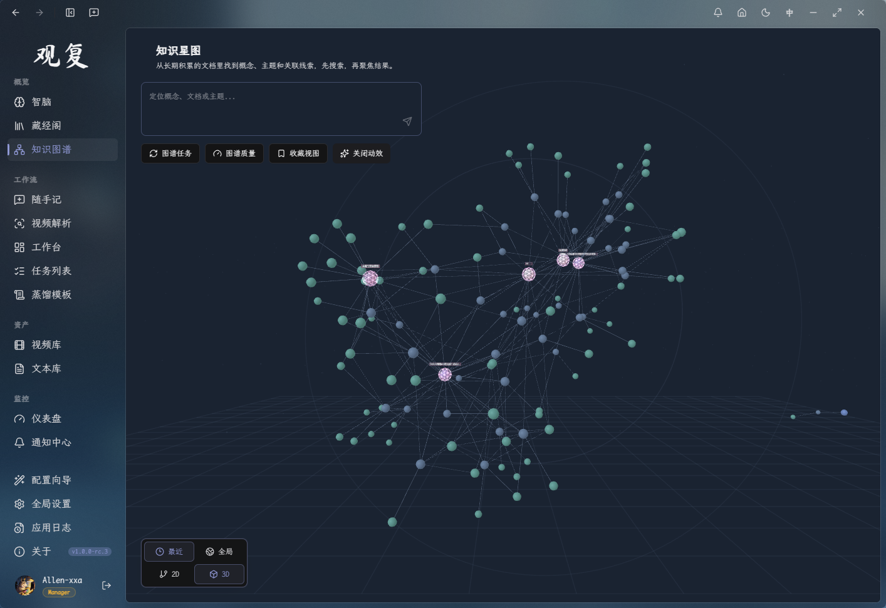

<!-- Banner 横幅位 -->

 

# 观复 · Nexus Cortex

**观万物，复归其用。**

*独立、本地优先、具备深度推理能力的 AI 个人知识工作台。*  
*将散落在视频、网页与速记中的信息碎片，重构为可追溯、可检索、可演化的深度知识体系。*

 

中文 · [English](README.en.md)
 
 

 

[下载安装](#-下载与安装) • [核心设计](#-核心设计) • [功能全景](#-功能全景) • [快速开始](#-快速开始) • [数据与安全](#-数据与安全) • [赞助与支持](#-赞助与支持)

---

## 💡 为什么选择观复？

 
在信息过载的时代，收藏极其廉价，但唤醒与使用成本极高。

海量的视频、网页标签和散乱的笔记逐渐沦为信息黑洞——**你记得自己看过，却再也找不到它；AI 给出了看似完美的答案，却无法提供确凿的来源。**

**观复（Nexus Cortex）** 重构了从信息摄入到知识内化的完整生命周期。它将“记录”作为起点，以“精准回溯与深度应用”为终点，在保证数据 100% 留存本地的前提下，打造真正值得信赖的数字大脑。

| 常见痛点 | 观复的系统化解法 |
| :--- | :--- |
| **视频信息密度高，难以检索引用** | 全自动音视频转写与结构化蒸馏，生成带时间戳与精准来源的正式文档 |
| **灵感与网页摘录散落各处，缺乏整理** | 统一零摩擦速记入口，先捕捉后归拢，多源素材无缝拼接成文 |
| **传统文件夹/标签分类僵化** | 混合向量检索 + 局部知识星图，让概念与关系自动连接并可回溯原文 |
| **AI 生成内容幻觉严重，缺乏凭据** | 智脑采用 RAG 证据优先机制，回答严格标注引用来源与证据质量评估 |
| **数据托管于 SaaS 平台，面临隐私与锁死风险** | 100% 本地优先架构，存储、转写、向量计算与重排均运行于本机 |

---

## 🔄 核心设计：全链路闭环

 

- **收进来 (Ingestion)** — 视频链接、网页文章、瞬时灵感与本地附件，统一沉淀至混沌入口，不打断心流。
- **理得清 (Processing)** — 素材与速记汇入整理队列，支持灵活拼接、追加与重做；确认后写入正式文档，源头始终可溯。
- **找得回 (Retrieval)** — 标题、全文与语义向量三重检索；局部知识星图动态展开，节点与边均可回溯至原始证据。
- **用得上 (Synthesis)** — 智脑基于本地证据链严谨作答；周期性报告自动生成，成果沉淀进“藏经阁”，随时可摘抄再发酵。
- **留得住 (Sovereignty)** — 全本地推理内核、本地 ASR 转写与向量重排；数据资产完全自主，目录随时迁移。

---

## 🛠️ 功能全景

### 🧠 智脑 RAG 引擎 (Cortex AI Engine)

 

以本地知识库为底座的严谨推理系统。
* **可信回答**：推演结论强制附带交叉引用序号，点击直达原文证据，拒绝“张冠李戴”。
* **证据质量看板**：显式展示命中切片数、覆盖文档数、图谱关联度及低置信度预警。
* **边界防御**：当证据不足或超范围时，明确告知事实缺失，而非捏造假象。

---

### 📚 藏经阁 (Scriptorium)

 

知识沉淀与二次创作的终极仓库。
* **分级拟物展柜**：智能分类智脑分析、周期报告、专题报告与社区洞察（灵光一闪）。
* **沉浸式阅读与反哺**：支持报告二次修改与证据片段固定；选中文本可一键“摘抄”回随手记进行二次发酵。

---

### ⚡ 随手记 (Quick Notes)

 

无门槛的高速输入通道。无论是闪现的灵感、剪切板中的 URL 还是文档截图，随手即记。
* **零负担捕捉**：只记录不打断，支持自动识别视频/网页链接并转化为待处理任务。
* **时间线视图**：通过热力日历回溯输入节奏与思考痕迹。
* **流转与拼接**：碎片内容可随时勾选并推送至工作台，作为长文创作的元素材。

---

### 🎥 自动化视频解析管道 (Video Pipeline)

 

支持 YouTube、Bilibili、抖音、TikTok 及本地音视频文件的批量导入与流水线处理。
* **多引擎 ASR**：内置 SenseVoice（CUDA 加速 / VAD 级时间戳）与 Whisper 引擎，同时支持云端 API 扩充。
* **结构化蒸馏**：结合内置或自定义 Prompt 模板，自动输出带关键帧、分段摘要与可编辑的 Markdown 文档。
* **原始数据留存**：支持“仅清洗入库”模式，保留完整可追溯的原始字幕与时间戳。

---

### 🌐 局部知识星图 (Knowledge Graph)

 

拒绝冗杂无用的全局密集球图，专注于与当前探索相关的局部网络。
* **证据回溯**：点击任意节点（文档、概念、实体）或关系边，直接定位至原文切片。
* **社区检测与灵光一闪**：自动计算紧密节点聚类，智能归纳社区主线并推演潜在联系。
* **多义词智能导读**：基于上下文自动消歧，归纳不同语境下的概念定义。

---

### 🏛️ 知识工作台 (Workspace)

 

双栏并排设计，连接混沌素材与结构化输出。
* **整理队列**：基于 `待整理 / 需重做 / 已完成 / 忽略` 的状态流转，清晰掌握整理进度。
* **动态拼接重构**：多条速记与视频片段支持自由排列、插入与追加，提供实时 DIFF 预览。
* **周期报告引擎**：按日、周、月维度自动归纳阶段性输入与思考，生成高价值总结。

---

### ⚡ 仪表盘与局域网 API (Dashboard & API)

 

* **全局监控**：实时查看 CPU/GPU 负载、显存占用、推理后端状态与存储容量。
* **开放 API & SSE**：支持局域网内其他 AI Agent / 工作流调用任务接口，将观复作为本地知识处理基础设施。

---

## 🚀 下载与安装

| 发行版本 | 文件名示例 | 说明 |
| :--- | :--- | :--- |
| **安装版 (Setup)** | `Guanfu-Setup-1.0.0.exe` | 推荐使用。包含平滑升级逻辑，自动清理历史版本 |
| **便携版 (Portable)** | `Guanfu-Portable-1.0.0.zip` | 解压即用。不写入系统注册表，适合随身盘或多机同步 |

> **系统要求**：Windows 10 / 11 64-bit。默认支持 NVIDIA 显卡（CUDA 加速），无独显设备将自动降级至 Vulkan 或 CPU 运行。

---

## ⚙️ 首次配置

首次启动时，配置向导将引导完成本地推理环境的构建：

1. **模型/资源包识别**：支持导入本地完整资源包或在线下载，自动检测并校验文件完整性（SHA256）。
2. **硬件检测与降级策略**：按 `CUDA → Vulkan → CPU` 顺序匹配最佳运行时。
3. **确定安装计划**：透明化展示受管模型与运行库写入路径，不影响任何用户已有数据。

> **提示**：核心文本管理与 ASR 转写功能完全独立。即使未配置云端 LLM，您依然可以顺畅使用视频解析、本地搜索及工作台功能。

---

## 🔒 数据隐私与安全承诺

* **全本地存储**：数据库（SurrealDB）、音视频文件、Markdown 文档及向量索引均存储于本地磁盘。
* **无私有数据上传**：转写、嵌入、重排及图谱构建均在本地离线执行。仅在下载视频或调用第三方云端模型 API 时产生必要网络请求。
* **凭据加密**：所有 Cookie、API Key 均使用本地安全密钥加密保存，脱敏显示，决不写入日志。

---

## ❓ 常见问题

<b>没有 NVIDIA 显卡（非 N 卡）能否顺畅使用？</b>

 
完全可以。向导会自动切至 Vulkan 或 CPU 模式，转写与检索功能均可正常工作。对于 CPU 设备，建议搭配更轻量化的 Whisper / SenseVoice 档位。

<b>为什么某些文档在语义搜索中无法匹配？</b>

 
请检查该文档的向量索引状态。未完成索引或文件修改后未更新的文档不参与向量匹配，可在文本库中手动触发“重建索引”。

---

## 📜 名字由来

> *“致虚极，守静笃。万物并作，吾以观复。”*  
> —— **《道德经》第十六章**

“观复”意为观察万物纷纭之变化，而见其复归于根本。  
在信息爆炸的当下，知识不应是无意义的堆砌与囤积，而应在被需要的时刻，清晰地复归于眼前，被重构、被引用、被用上。

---

## ☕ 赞助与支持

#### 🙏 容作者卖个惨，强制性脊柱炎三期患者，多数时间都是在床上一边忍着疼一边跟Agent对喷、修改代码和确定业务逻辑，虽然更多时候我喷不过它，它总是有自己的想法。
#### 观复（Nexus Cortex）是一个完全独立的个人项目，精心打磨了半年时间，即使住院也几乎没有停止开发。如果您觉得它切实改变了您知识积累和使用的体验，欢迎请作者喝杯咖啡，支持项目的持续维护与演进：

 
<i>扫码赞助 · 心意无价</i>

---

## 🙏 致谢与开源生态

观复的成长离不开以下优秀的开源项目与社区基石：

- **Core & Runtime**: [Tauri](https://tauri.app/) · [llama.cpp](https://github.com/ggerganov/llama.cpp) · [SurrealDB](https://surrealdb.com/) · [whisper.cpp](https://github.com/ggerganov/whisper.cpp)
- **Media & Processing**: [yt-dlp](https://github.com/yt-dlp/yt-dlp) · [FFmpeg](https://ffmpeg.org/) · [SenseVoice / FunASR](https://github.com/modelscope/FunASR) · [DrissionPage](https://github.com/g1879/DrissionPage)
- **Models**: [Qwen 系列](https://github.com/QwenLM) · [BGE 系列](https://github.com/FlagOpen/FlagEmbedding)
- **Frontend & Visualization**: React · Tailwind CSS · Radix UI · Sigma.js · Graphology

---

**观复 (Nexus Cortex)** · 观万物，复归其用

[最新 Release](../../releases/latest) • [提交 Issue](../../issues) • [English README](README.en.md)

